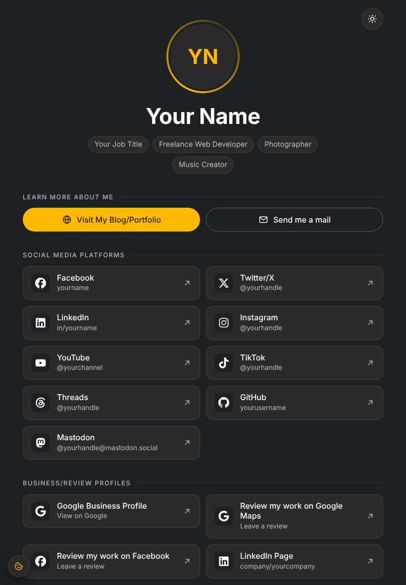
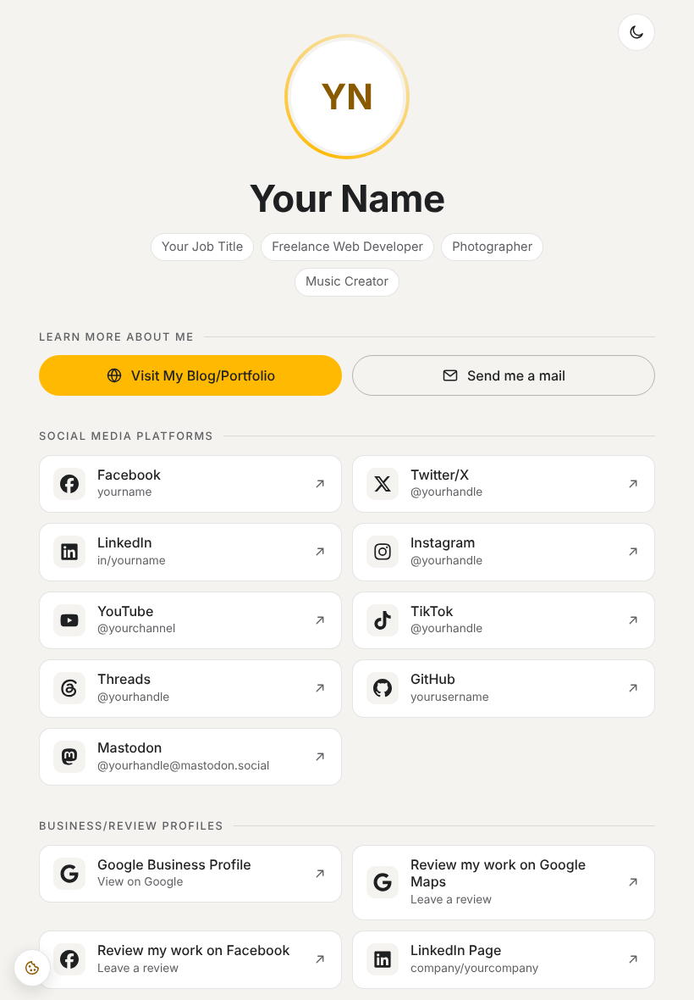

# Social Links Page

A fast, private "link in bio" page in plain HTML, CSS and JavaScript. It has no framework, no build step, no database, and loads nothing from third-party servers.

| Dark | Light |
|---|---|
|  |  |

## Features

- **One page for all your links:** social profiles, business and review profiles, and music releases, plus email, website and vCard download buttons and a QR code.
- **Brand icons** from Font Awesome Free 7.3.1, drawn straight into the page (no icon font to download). A small tool adds or swaps icons.
- **Light/dark mode.** It follows the visitor's device setting by default, and a toggle button switches it. The choice is remembered only with consent.
- **Self-hosted cookie banner** with Functional, Preferences, Statistics and Marketing categories. Scripts can wait for consent.
- **Cookie Policy and Privacy Policy pages (EU/GDPR)** as templates that describe exactly what the page does.
- **Privacy and security by default:** a strict Content-Security-Policy, no inline scripts or styles, and no trackers.
- **Accessible:** semantic HTML, keyboard focus styles, screen-reader labels, WCAG AA contrast in both themes and reduced-motion support.
- Responsive from 320 px phones up, with print styles.

## Quick start

1. Download or clone this repository.
2. Preview it locally:
   ```bash
   python3 -m http.server 8000 --directory public
   ```
   Then open http://localhost:8000.
3. Replace the placeholders (see [Make it yours](#make-it-yours)).
4. Upload the **contents** of `public/` to any static web host (see [Deploy](#deploy)).

## Project structure

```
public/                          ← the website: only this folder's contents go on the server
  index.html                     main page: profile, links, vCard/QR, cookie banner
  cookie-policy/index.html       Cookie Policy (EU)   → /cookie-policy/
  privacy-policy/index.html      Privacy Policy (EU)  → /privacy-policy/
  assets/css/style.css           all styles; colors are variables at the top
  assets/js/theme.js             light/dark mode (loaded in <head>, so there's no flash)
  assets/js/main.js              cookie banner and small helpers
  assets/img/                    your photo (avatar.jpg) and QR code (qr-code.png)
  assets/fonts/                  optional Roboto .woff2 files
  assets/contact.vcf             vCard behind the "Download vCard" button
  favicon.svg                    placeholder "YN" icon
brand-icons/                     icon SVGs (Font Awesome Free) — source files, not uploaded
tools/brand-icons.py             draws brand-icons/*.svg into the page and builds site-upload.zip
docs/                            screenshots for this README
```

## Make it yours

Search the project for these placeholders and replace them:

| Placeholder | Where |
|---|---|
| `Your Name`, `YN` (monogram) | all three pages, `favicon.svg`, `contact.vcf` |
| `you@example.com` | main page (mail button), both policies, `contact.vcf` |
| `example.com`, `socials.example.com` | links, canonical/Open Graph tags, policies |
| `yourname`, `yourhandle`, `yourchannel`, `yourusername`, `yourpage`, `yourcompany` | social links on the main page |
| `YOUR-…-ID` | Google, YouTube Music, Spotify, Apple Music, Deezer and Amazon Music links |
| `[Square brackets]` | Cookie Policy and Privacy Policy: your name, country, date, hosting/CDN provider, data protection authority |

**Photo and QR code**
- Save a square photo as `public/assets/img/avatar.jpg`. About 400×400 px is plenty. Without it, the page shows the monogram.
- Save a QR code that points to your page as `public/assets/img/qr-code.png`, for example with `qrencode -s 8 -o public/assets/img/qr-code.png https://socials.example.com/`. Without it, the QR box is hidden.

**vCard:** edit `public/assets/contact.vcf`. Keep the Windows line endings (CRLF), which some phones expect.

**Fonts (optional):** put `roboto-400.woff2`, `roboto-500.woff2` and `roboto-700.woff2` in `public/assets/fonts/`. Without them, the device's system font is used.

**Favicon:** replace `public/favicon.svg`, or use a full favicon set (see the comment in each page's `<head>`). An SVG favicon must be real vector art. A PNG embedded inside an SVG file is blocked by the security policy.

### Adding, removing or reordering links

Every link is one `<li>` block in `public/index.html`. Copy one and change it:

```html
<li><a class="link" href="https://bsky.app/profile/yourhandle" target="_blank" rel="noopener">
  <svg class="ico ico-brand" aria-hidden="true"><use href="#b-bluesky"/></svg>
  <span class="link-text"><span class="link-name">Bluesky</span><span class="link-handle">@yourhandle</span></span>
  <svg class="ico arrow" aria-hidden="true"><use href="#i-arrow"/></svg><span class="sr-only">(opens in a new tab)</span></a></li>
```

1. **`href`** is the full profile address.
2. **`link-name`** is the name shown on the card.
3. **`link-handle`** is optional. Delete that `<span>` to show only the name.
4. **The icon:** save Font Awesome's `bluesky.svg` (from `svgs/brands/` in the Font Awesome Free download) as `brand-icons/bluesky.svg` and run `python3 tools/brand-icons.py`. The tool creates the `#b-bluesky` slot. Without a brand icon, use a generic one: `<svg class="ico" aria-hidden="true"><use href="#i-chat"/></svg>`. The generic icons are `i-globe`, `i-mail`, `i-user`, `i-chat`, `i-play`, `i-camera`, `i-code`, `i-briefcase`, `i-pin`, `i-star`, `i-music` and `i-wave`.

- Links appear in the order they're written.
- To remove a link, delete its `<li> … </li>`.
- To highlight a link with the accent border, use `class="link link-accent"`.
- To add a section, copy a whole `<section class="block">`, then give its `<h2>` a new `id` and point the section's `aria-labelledby` at it.
- Keep `rel="me noopener"` on your Mastodon link (and the `<link rel="me">` in `<head>`) to get the verified check on Mastodon.

## Brand icons

The included slots are Facebook, X, LinkedIn, Instagram, YouTube, YouTube Music¹, TikTok, Threads, GitHub, Mastodon, Google, Apple Music¹, Spotify, SoundCloud, Deezer, Amazon Music and Tidal.
<sub>¹ Font Awesome has no YouTube Music or Apple Music icon, so these slots use `youtube` and `itunes-note`.</sub>

```bash
python3 tools/brand-icons.py                 # single-color icons (follow the theme)
python3 tools/brand-icons.py --keep-colors   # keep an SVG's own colors (multi-color official logos)
```

The tool needs only Python 3, with nothing to install. It cleans every SVG, removing scripts, links, embedded images and inline styles, then draws it into `public/index.html` and builds `site-upload.zip`. You can also drop in a brand's own official SVG instead of a Font Awesome icon.

The logos are trademarks of their owners. Use them only to link to your own profiles.

## Light / dark mode

- **On a first visit,** the page follows the device's light or dark setting and stores nothing.
- **When the visitor presses the toggle,** the choice is kept for the tab (`sessionStorage`, functional). It's remembered across visits (`localStorage`) only if they allow **Preferences** in the cookie banner. Withdrawing Preferences deletes it.
- **To always start in dark,** set `var DEFAULT = 'dark';` in `public/assets/js/theme.js`.
- **The colors** are CSS variables at the top of `style.css`. The light palette appears twice, in `:root[data-theme="light"]` and in the `prefers-color-scheme: light` block, so keep both the same. If you change a background color, also update `COLORS` in `theme.js` and the `theme-color` meta tags.

| Variable | Dark | Light | Used for |
|---|---|---|---|
| `--c-primary` | `#1F2022` | `#F5F3EF` | page background, icon tiles |
| `--c-secondary` | `#2B2B2B` | `#FFFFFF` | cards, footer, banner |
| `--c-text` | `#FDFBFB` | `#1F2022` | text, brand icons |
| `--c-accent` | `#FFB900` | `#FFB900` | buttons and fills |
| `--c-accent-ink` | `#FFB900` | `#8A5A00` | links, icons and borders (darker in light mode for contrast) |

## Cookie banner and policies

- The page sets **one cookie,** `cookie_consent` (functional, 12 months), and only after a click. It stores the allowed categories and the date. The theme choice uses browser storage as described above.
- **Scripts that need consent** are written as
  ```html
  <script type="text/plain" data-consent="statistics" data-src="assets/js/stats.js"></script>
  ```
  and run only after the visitor allows that category. Add whatever they store to the Cookie Policy table.
- **When the policy changes,** update the "Last updated" date and raise `POLICY_VERSION` in `main.js`, so everyone is asked again.
- **The policy texts** describe what this page does (one functional cookie, theme storage, server logs, no third-party content) and are written for the EU (GDPR/ePrivacy). Fill in the bracketed placeholders and adapt them to your situation. **They are a starting point, not legal advice.**

## Deploy

Upload the **contents** of `public/` so that `index.html` sits in your web root. `python3 tools/brand-icons.py` builds `site-upload.zip` with exactly that. Any static host works, including nginx, Apache, GitHub Pages, Netlify and Cloudflare Pages. The Content-Security-Policy is already in each page as a `<meta>` tag.

On your own nginx server, also send the security headers, and stop browsers from caching HTML for long:

```nginx
add_header Content-Security-Policy "default-src 'self'; img-src 'self'; style-src 'self'; script-src 'self'; font-src 'self'; connect-src 'none'; object-src 'none'; base-uri 'self'; form-action 'none'; frame-ancestors 'none'" always;
add_header X-Content-Type-Options "nosniff" always;
add_header Referrer-Policy "strict-origin-when-cross-origin" always;
add_header Permissions-Policy "camera=(), microphone=(), geolocation=()" always;

location ~* (\.html|/)$ {
    add_header Cache-Control "no-cache" always;
    # nginx drops server-level add_header lines inside a location that has its own: repeat the four above here
}
```

**After editing CSS or JS,** change the `?v=…` stamp on the `style.css`, `theme.js` and `main.js` links in all three pages. Visitors then get the new files instead of cached ones.

**Behind a CDN or page optimizer** (BunnyCDN, Cloudflare, Varnish, ngx_pagespeed and the like), purge the cache after each upload. Turn off "optimizers" that rewrite or inline CSS/JS: the site is already small, and their injected inline scripts are blocked by the CSP.

## Credits

- Brand icons: [Font Awesome Free](https://fontawesome.com) 7.3.1 by Fonticons, Inc., licensed [CC BY 4.0](https://creativecommons.org/licenses/by/4.0/). The license is in `brand-icons/FONT-AWESOME-LICENSE.txt`, and the attribution comment is kept in the page's icon sprite. Brand logos are trademarks of their respective owners.
- Built by [@idzanhr](https://github.com/idzanhr) with [Claude](https://claude.ai) (Anthropic) as co-author.

## License

The code and templates are under the [MIT License](LICENSE). The Font Awesome icons in `brand-icons/` and in the page sprite are under CC BY 4.0, as described above.
